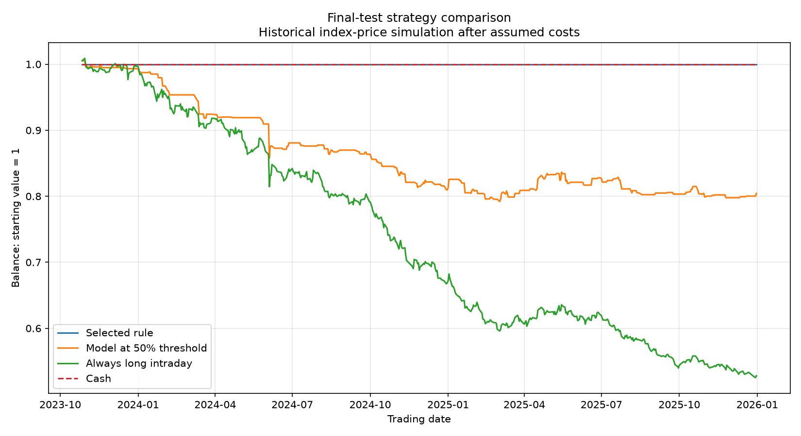

# Market Model Lab

A Python research project comparing machine-learning models for next-day intraday market-direction prediction.

## Research question

Can machine learning improve on a simple baseline, and can a probability-based trading rule identify when to participate or stay in cash?

## Tools

Python, pandas, NumPy, scikit-learn, PyTorch, Matplotlib and SQLite.

## Data and features

Historical NIFTY 50 index prices were downloaded through yfinance for 2015–2025.

- Downloaded rows: 2,708.
- Prepared examples: 2,688.
- Features: one-day return, five-day return, moving-average ratio, recent volatility and daily price range.
- Target: whether the following trading day's close exceeds its opening price.

Features use information available after the prediction day's close.

## Evaluation

Examples remain in chronological order:

- Training: 1,611 rows.
- Validation: 537 rows.
- Test: 538 rows.

One example is excluded at each split boundary because labels use the following day's prices. Scaling is fitted on training data only.

Models include a majority-class baseline, logistic regression, gradient boosting and a small PyTorch neural network.

## Validation results

| Model | Accuracy | Balanced accuracy |
|---|---:|---:|
| Gradient boosting | 51.02% | 50.30% |
| Baseline | 51.77% | 50.00% |
| Logistic regression | 51.02% | 49.37% |
| PyTorch neural network | 50.28% | 48.67% |

Gradient boosting led on the chosen metric, balanced accuracy, but its advantage over the baseline was small. The neural network did not improve validation performance.

The neural-network extension was developed after the original test results had been viewed and is labelled exploratory. It was evaluated on validation data only.

## Trading experiment

Four predefined probability thresholds were compared using validation data.

A qualifying rule required positive validation returns after assumed costs and at least 54 trades. No threshold qualified, so the selected rule stayed in cash.

| Test strategy | Trades | Simulated total return |
|---|---:|---:|
| Selected rule: cash | 0 | 0.00% |
| Model at 50% threshold | 153 | -19.57% |
| Always long intraday | 538 | -47.19% |
| Cash comparison | 0 | 0.00% |

Each active trade assumes a total entry-plus-exit cost of 0.10%.

This experiment did not demonstrate a profitable trading strategy. Staying in cash avoided the observed losses but does not demonstrate predictive skill.

## Analysis and SQL

The project compares performance across calm and volatile conditions using a volatility cutoff calculated from training data.

SQLite stores daily results, strategy comparisons and validation scores. SQL queries rank models and summarize trading activity.

## Run

Create and activate a Python virtual environment, then install dependencies:

    python -m pip install -r requirements.txt

Run these scripts in order:

    python download_data.py
    python prepare_data.py
    python train.py
    python backtest.py
    python evaluate_test.py
    python analyse_results.py
    python train_neural.py
    python save_research.py

## Limitations

- Index prices are a research proxy, not executable trades.
- Opening/closing fills and fixed transaction costs are simplified assumptions.
- The always-long intraday strategy is not overnight buy-and-hold.
- Estimated probabilities have not been calibrated.
- One instrument and one historical test period do not establish general performance.
- Further experiments using the already-viewed test period must be labelled exploratory.
- This is a research prototype, not a deployed trading application.

## Development

Built with AI assistance as a learning project. Code, assumptions and findings should be understood and independently checked before presenting them in an interview.